<p align="center">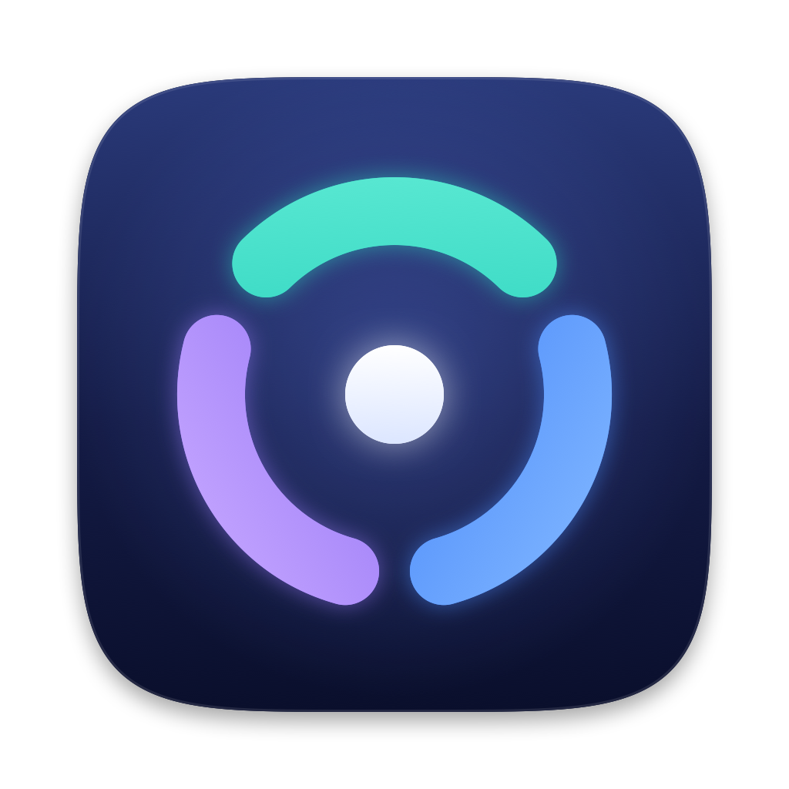</p>

<h1 align="center">Claude Pool</h1>

<p align="center">
A native macOS menu bar app for people who use more than one Claude Code account.<br>
Switch accounts without <code>/logout</code>, see every account's limits at a glance, and keep sessions on the right account.
</p>

<p align="center">
<a href="https://github.com/bahrulbangsawan/claude-pool/releases/latest"><b>Download the latest release</b></a> · macOS 14+ · Apple silicon
</p>

**Install in one line** (downloads the latest release into `/Applications` and opens it, with no Gatekeeper prompt):

```sh
curl -fsSL https://raw.githubusercontent.com/bahrulbangsawan/claude-pool/main/install.sh | sh
```

<p align="center">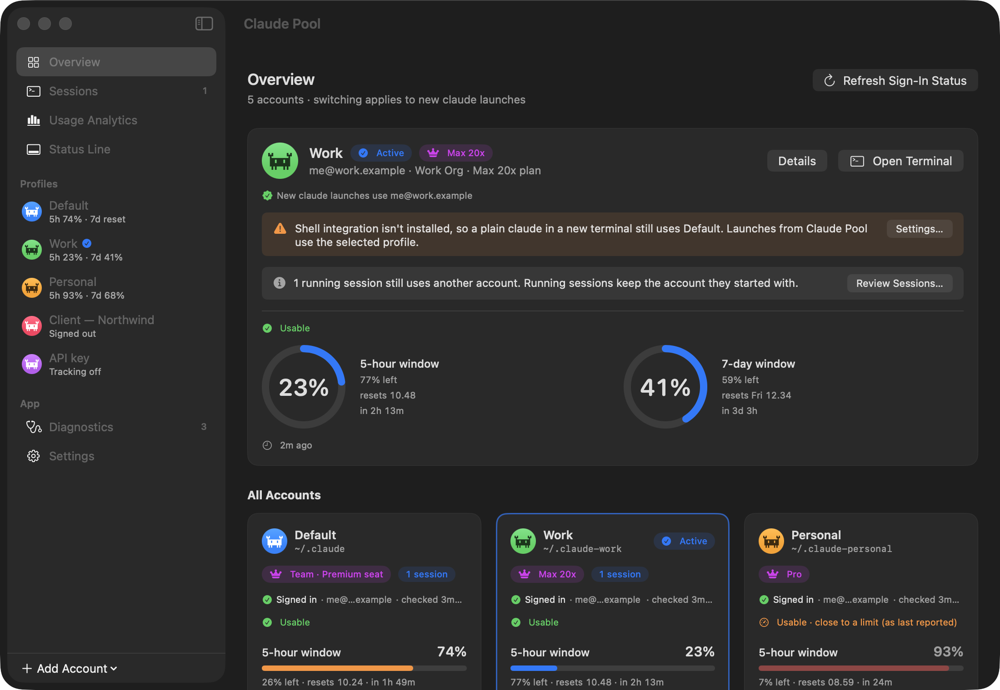</p>

> Unofficial utility. Not affiliated with or endorsed by Anthropic. The app icon and avatars are original pixel art of a crab, inspired by the Claude Code mascot; all other icons are SF Symbols.

**"Pool"** means a pool of separately signed-in accounts that **you** switch between by hand. Claude Pool does not pool, combine, rotate or load-balance usage limits, and it never switches for you. The limit alerts and the suggestion are off by default and only inform you: Anthropic's Usage Policy forbids intentionally bypassing restrictions in its products, and automatic switching to keep going past a limit would come too close to that.

## Contents

- [Features](#features)
  - [Menu bar](#menu-bar)
  - [Overview](#overview)
  - [Profiles and usage history](#profiles-and-usage-history)
  - [Sign in without Terminal](#sign-in-without-terminal)
  - [Sessions and handoff](#sessions-and-handoff)
  - [Usage analytics](#usage-analytics)
  - [Status line manager](#status-line-manager)
  - [Usage tracking (opt-in)](#usage-tracking-opt-in)
  - [Limit alerts and suggestion (opt-in)](#limit-alerts-and-suggestion-opt-in)
  - [Shared extensions](#shared-extensions)
  - [Diagnostics](#diagnostics)
  - [Settings](#settings)
- [Install](#install)
- [Getting started](#getting-started)
- [How it works](#how-it-works)
- [Requirements](#requirements) · [Build, test, run](#build-test-run) · [Files](#files) · [Limitations](#limitations) · [Troubleshooting](#troubleshooting-by-diagnostics-check)

---

## Features

### Menu bar

<p align="center"></p>

The menu bar shows the pixel-crab mark, the active profile and its limits (`Work · 5h:23% · 7d:41%`), and optionally this Mac's CPU and memory. Each part can be turned off in Settings.

<p align="center">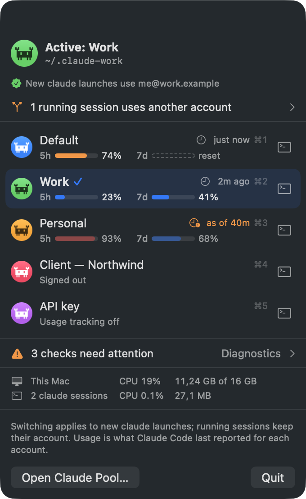</p>

Click it for the panel:

- **Active profile** and a verified line naming the account new `claude` launches will use.
- **Every profile** with its 5-hour and 7-day bars, how fresh the values are, a ↻ **Check Usage Now** button and a Terminal button. Click a row (or press ⌘1–⌘9) to make it active.
- A warning when a **running session uses another account**, and when **Diagnostics** need attention.
- **CPU and memory** of this Mac and of all running `claude` sessions.

### Overview

<p align="center"></p>

The Overview shows the active account in detail: email, organisation, plan, both usage rings with reset times, and whether switching is fully in effect (for example, a warning if the shell integration isn't installed). **All Accounts** lists every profile as a card with its plan, sign-in state, running sessions and usage bars, always in your own order. When two profiles show the same email but their usage resets at different times, both get a warning with **Sign In Again…**: one account has only one set of windows, so one of the saved sign-ins is out of date.

### Profiles and usage history

<p align="center">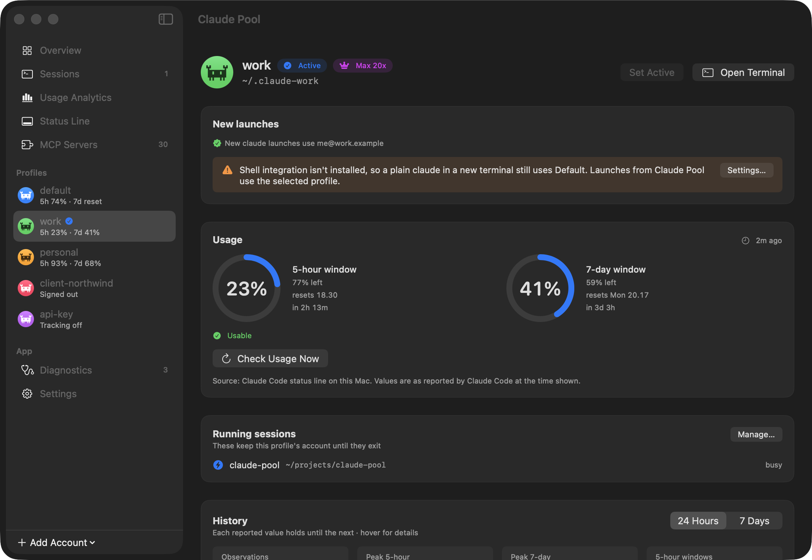</p>

Each profile is one Claude Code config directory with its own sign-in. Its page shows:

- **Set Active** and **Open Terminal** (runs `claude` with that profile, even without the shell integration), in a new Terminal window or a new [herdr](https://herdr.dev) tab.
- The plan, as specifically as Claude Code's data allows (Pro, Max 5x, Max 20x, Team seat …).
- The **5-hour and 7-day windows** exactly as Claude Code reported them, with when they reset and how old the values are. Usage is never estimated.
- The profile's **running sessions**.
- A **history** chart of observed values over 24 hours or 7 days, one line per window: each value holds until the next and drops to 0 at a reset. Hover snaps to a real observation.

<p align="center">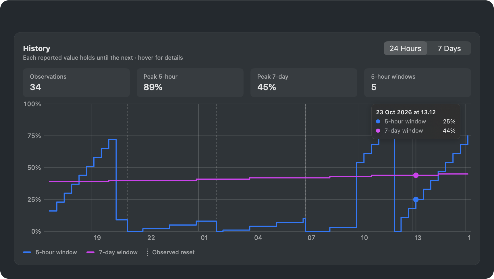</p>

### Sign in without Terminal

<p align="center">
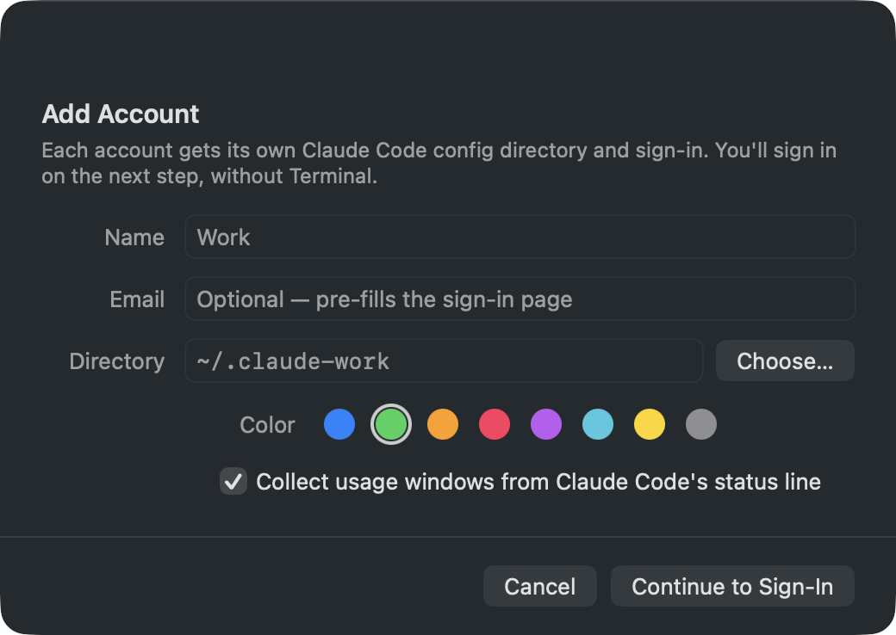
&nbsp;
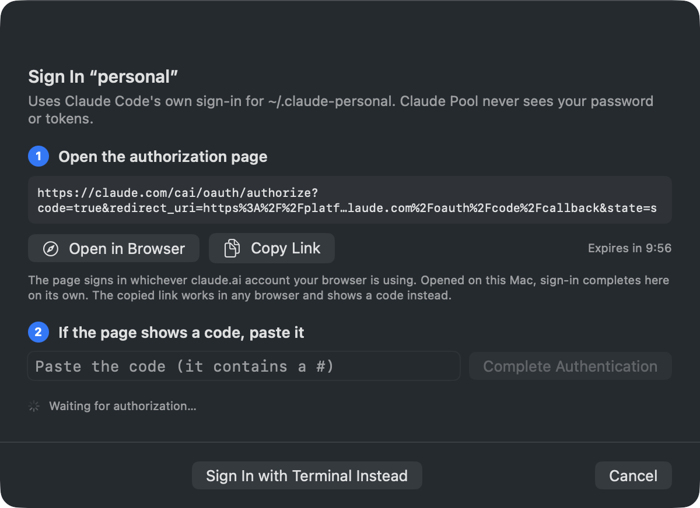
</p>

**Add Account** creates a profile directory and signs it in by driving Claude Code's own `claude auth login`. Open the link in your browser (it completes on its own), or copy it and paste the code back. A 10-minute countdown, Cancel and **Start Again** are built in, and a duplicate account is flagged. **Sign In with Terminal** is still available, and **Adopt Existing…** picks up directories such as `~/.claude-work` you already have.

### Sessions and handoff

<p align="center">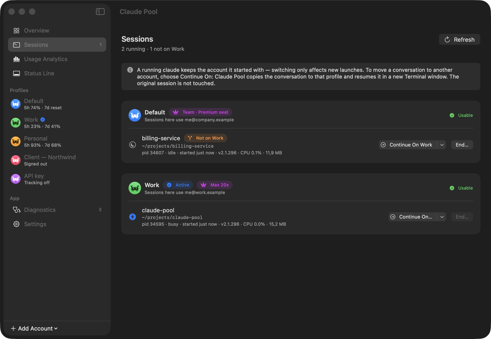</p>

The Sessions page lists every running `claude` process grouped by profile, with its folder, state (busy, idle), version, CPU and memory, and flags any session that isn't on the active account. A running session can never change accounts (see [why](#why-a-switch-cant-change-a-running-session-root-cause)), so instead:

<p align="center">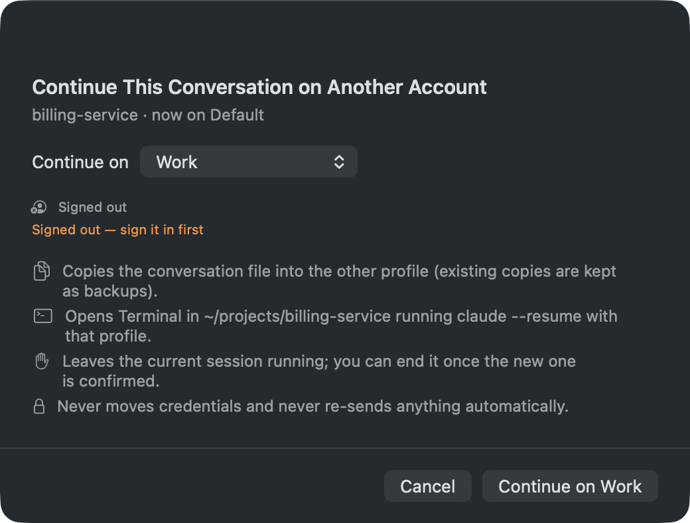</p>

**Continue On…** copies the conversation into the other profile and opens Terminal running `claude --resume` there. The original session is left running until you **End…** it, and the handoff is marked **Confirmed** only when Claude Code registers the resumed session under the new profile.

### Usage analytics

<p align="center">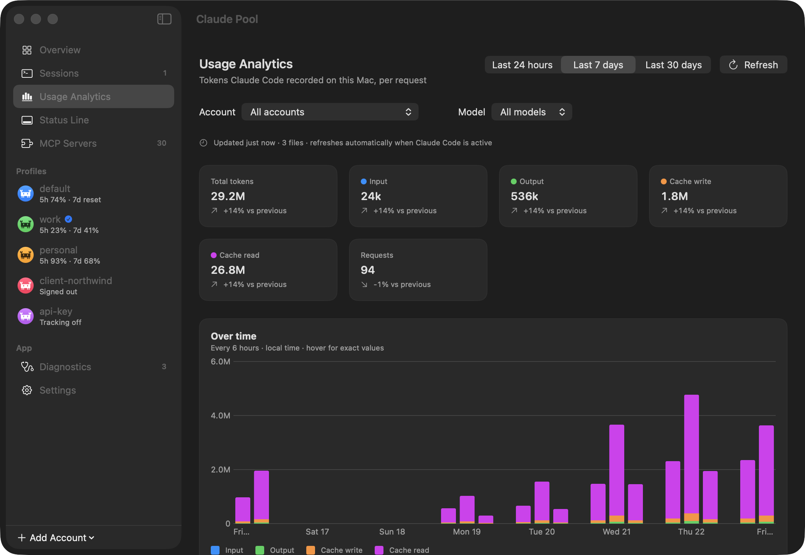</p>

Token usage that Claude Code recorded on this Mac (input, output, cache write, cache read, and requests) per account and model, over the last 24 hours, 7 days or 30 days, compared with the previous period. Responses are deduplicated, only usage numbers are read, and the index updates incrementally whenever Claude Code is active. Token counts are not subscription quota; the windows are shown separately.

### Status line manager

<p align="center">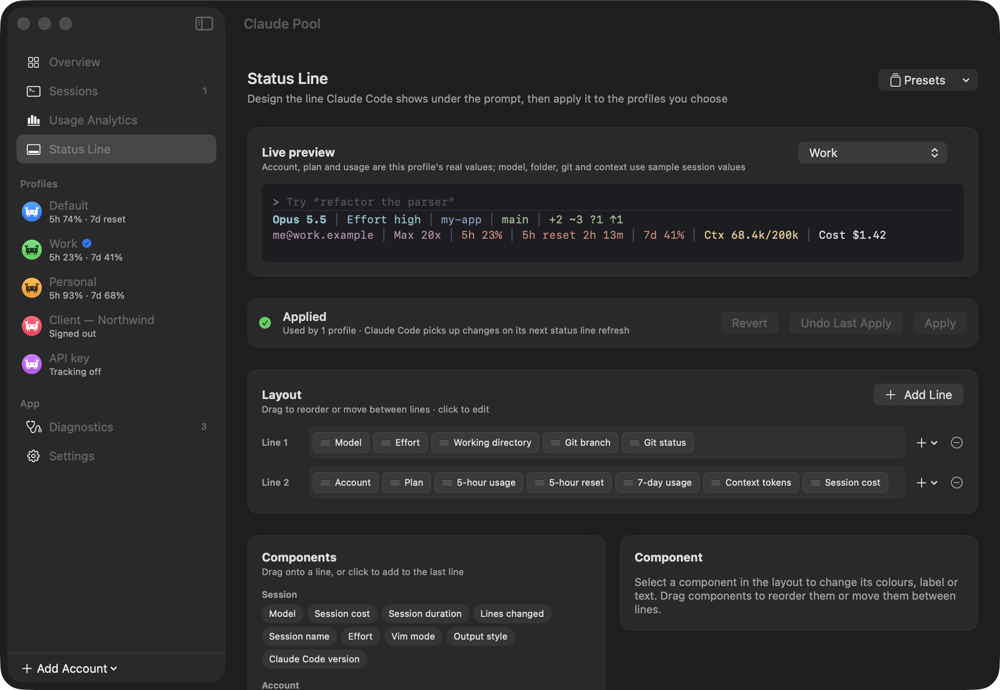</p>

Design the line Claude Code shows under the prompt: drag components onto lines, choose colours, themes, separators and Powerline, preview it live with each profile's real account, plan and usage, and apply it to the profiles you choose. **Undo Last Apply**, saved presets and ccstatusline import are included. Components include model, account, plan, folder, git branch and status, context, cost, 5-hour and 7-day usage and reset countdowns, effort, and your original status line.

### Usage tracking (opt-in)

<p align="center">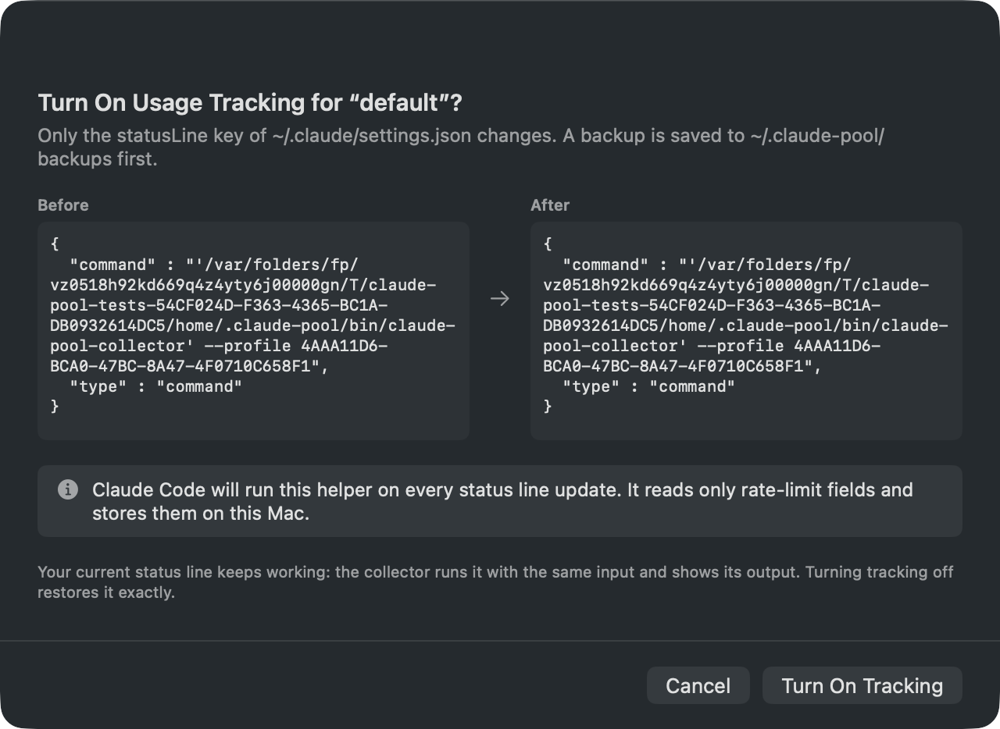</p>

Usage windows come from Claude Code's own status line data. Turning tracking on for a profile shows the exact `statusLine` change **before and after**, backs up `settings.json` first, and keeps your existing status line working. The bundled helper reads only the rate-limit fields, stores them on this Mac, and makes no network calls. Turning tracking off restores the original exactly. Details: [Usage tracking](#usage-tracking-opt-in-per-profile) and [The tracking opt-in](#the-tracking-opt-in).

### Limit alerts and suggestion (opt-in)

<p align="center">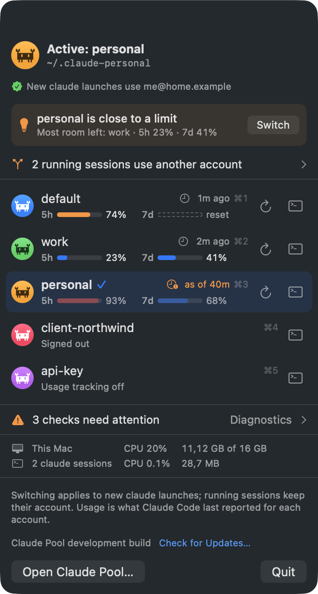</p>

Both are off by default (Settings › Limit Alerts). **Notify near and at a limit** sends one notification per window per reset period. **Suggest the account with the most room** shows, while the active account is close to a limit, the signed-in profile with the lowest reported usage, with a **Switch** button. Nothing ever switches on its own.

### Shared extensions

Each profile is a separate Claude Code config directory, so by default an MCP server, skill or plugin installed under one account doesn't exist in the others. **Settings › Shared Extensions** (on by default) keeps them the same everywhere: MCP servers (user scope), skills, agents, commands, output styles, `CLAUDE.md`, enabled plugins and marketplaces, hooks and permission rules. Install or remove one in any profile and every profile follows, including profiles you add later. Sign-ins, the status line, theme and model stay per account. Details: [Shared extensions](#shared-extensions-1).

### Diagnostics

<p align="center">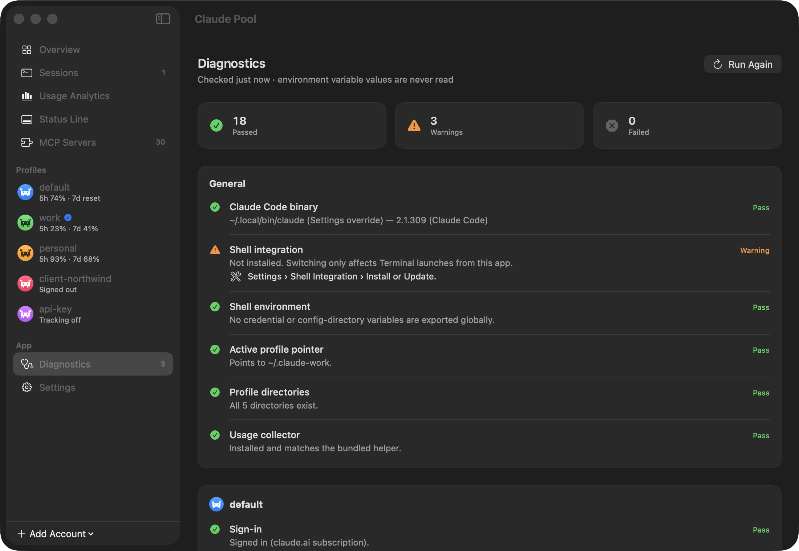</p>

One page checks everything switching and tracking depend on: the Claude Code binary, the shell integration, globally exported credential variables (names only, never values), the active-profile pointer, profile directories, the usage collector, and each profile's sign-in, sign-in method, config isolation and tracking. Every warning comes with a fix. See [Troubleshooting](#troubleshooting-by-diagnostics-check).

### Settings

<p align="center">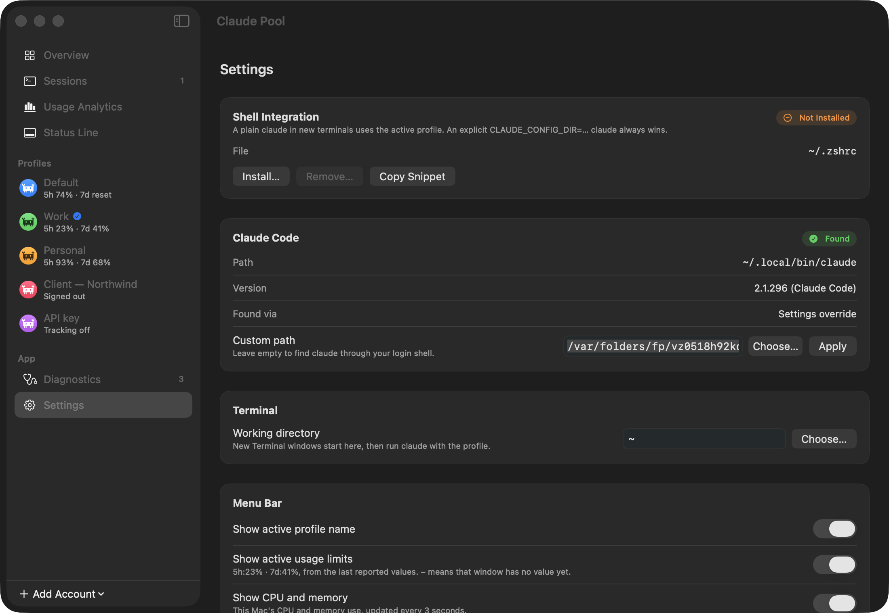</p>

Install or remove the shell integration (or copy the snippet), point to a custom `claude` binary, choose whether Open Terminal uses Terminal or a herdr tab (with an in-app herdr install), set the working directory for new windows, choose what the menu bar shows, share extensions across profiles, configure limit alerts, the collector's output, and launch at login.

---

## Install

**Quickest:** run this in Terminal. It installs the latest release into `/Applications` and opens it ([install.sh](install.sh)). Files downloaded with `curl` aren't quarantined, so macOS doesn't show the "Not Opened" warning.

```sh
curl -fsSL https://raw.githubusercontent.com/bahrulbangsawan/claude-pool/main/install.sh | sh
```

**Or install by hand:**

1. Download `ClaudePool-<version>.dmg` from the [latest release](https://github.com/bahrulbangsawan/claude-pool/releases/latest).
2. Open it and drag **Claude Pool** to **Applications**.
3. The app is not yet notarized by Apple, so the first launch shows **"ClaudePool" Not Opened**. Click **Done** (not Move to Trash), then either:
   - open **System Settings › Privacy & Security**, scroll to *"ClaudePool" was blocked*, click **Open Anyway** and confirm, or
   - run once in Terminal:
     ```sh
     xattr -dr com.apple.quarantine /Applications/ClaudePool.app
     ```
   On macOS 15 and later, right-click › Open no longer skips this check.

Or build it yourself: see [Build, test, run](#build-test-run).

## Getting started

1. Click the crab in the menu bar › **Open Claude Pool…**. Your existing `~/.claude` sign-in is already there as **Default**.
2. **Add Account** › enter a name. The directory defaults to `~/.claude-<name>` (mode 0700). Sign in in the sheet, in your browser.
3. Click a profile › **Set Active**. Claude Pool verifies the switch and tells you which account new launches will use.
4. Install the shell integration (**Settings › Shell Integration › Install…**) so a plain `claude` in any new terminal follows the active profile. Without it, use **Open Terminal**.
5. Optionally turn on **Usage tracking** for each profile to see its 5-hour and 7-day windows, then start a `claude` session and send one message.

Run `/status` inside `claude` to see which account a session is using.

---

## How it works

### Switching

Claude Code keeps settings, session history and the claude.ai sign-in **per config directory**. The directory comes from `CLAUDE_CONFIG_DIR` and defaults to `~/.claude`. On macOS the sign-in lives in the Keychain, and when `CLAUDE_CONFIG_DIR` is set the Keychain entry is keyed to that directory. Different directories therefore hold independent sign-ins.

- Each **profile** is one config directory. The built-in **Default** profile is `~/.claude` and always runs with `CLAUDE_CONFIG_DIR` **unset**, never set to `~/.claude`, so it keeps your existing default sign-in.
- Selecting a profile writes its directory to `~/.claude-pool/active`. Selecting Default empties that file.
- The optional **shell integration** adds a small `claude()` function to `~/.zshrc` (or `~/.bash_profile`). When `CLAUDE_CONFIG_DIR` is not already set, it reads the pointer and runs `command claude` with that directory. An explicit `CLAUDE_CONFIG_DIR=… claude` always wins.
- **Open Terminal** writes a one-off `.command` script and opens it in Terminal.app. The script exports or unsets `CLAUDE_CONFIG_DIR` and then runs `claude`. This works even without the shell integration, and it needs no Apple Events permission.
- An environment variable is fixed when a process starts. **Switching affects only `claude` processes launched afterwards**; running sessions keep their account. Two Terminal windows from different profiles run side by side on different accounts.
- Run `/status` inside `claude` to see which account is active.

### Why a switch can't change a running session (root cause)

Verified against Claude Code 2.1.296 (strings in the shipped binary plus live checks):

- The sign-in lives in the macOS Keychain under `Claude Code-credentials` (Default) or `Claude Code-credentials-<first 8 hex of sha256(config dir)>` (when `CLAUDE_CONFIG_DIR` is set). A process only ever looks up the entry for **the config directory it started with**.
- Each process memoizes its OAuth credentials in memory. It re-reads its own Keychain entry only on a 401, a "sibling login" check while it shows a login notice, or certain settings fetches — not after a 429 (usage limit).
- `CLAUDE_CONFIG_DIR` is fixed for the life of the process. Claude Pool's switch rewrites `~/.claude-pool/active`, which the shell function reads **only when launching** `claude`.

So switching the active profile can never redirect an existing session, and making it do so would require copying credentials between Keychain entries (refresh-token rotation would then break the other profile) — which Claude Pool deliberately does not do. Instead it offers a verified, explicit **handoff**.

### Sessions and handoff

- Claude Code registers each running process in `<configDir>/sessions/<pid>.json` (pid, session id, folder, status). Claude Pool lists them per profile, verifies the pid is still the same process (start time vs. `procStart`), and shows the account that profile is signed in to. The **Sessions** page, the menu and the Overview flag sessions that are not on the active account.
- **Continue On…** (per session): re-checks the target profile's sign-in, copies the conversation file (`projects/<key>/<id>.jsonl` and its `<id>/` folder) into the target profile byte-for-byte (an existing copy is renamed, never overwritten), and opens Terminal in the session's folder running `claude --resume <id>` with the target's `CLAUDE_CONFIG_DIR`. It is marked **Confirmed** only when Claude Code itself registers the resumed session under the target profile; otherwise **Not confirmed** after 2 minutes.
- The original process is never signalled automatically. **End…** (idle sessions only, after confirmation) sends it SIGTERM.
- Alternative supported by Claude Code: run `/login` inside the session. That re-signs **that profile's directory** to the other account (the profile then is that account).

### Verified switching

After **Set Active**, Claude Pool reads the pointer file back and runs `claude auth status` for the target. The UI says "New claude launches use <email>" only when the pointer on disk names that profile and the sign-in check passes; otherwise it shows the reason (signed out, overridden by an API key, pointer mismatch, isolation broken). Without the shell integration it warns that a plain `claude` in a new terminal still uses Default.

### Sign-in without Terminal

**Add Account** creates the profile directory, then runs the unmodified `claude auth login --claudeai` for it in the background (`CLAUDE_CONFIG_DIR` set, no TTY). Verified behaviour of Claude Code 2.1.296 in this mode:

- It prints a manual authorization URL (its page shows a code) and waits on stdin for "Paste code here if prompted".
- It also starts its own localhost callback and asks `$BROWSER` to open a second URL. Claude Pool sets `BROWSER` to a two-line script (in `~/Library/Caches/ClaudePool/login-<id>/`, removed afterwards) that only records that URL.

The sheet shows the link with **Open in Browser** (callback URL — completes on its own) and **Copy Link** (manual URL — works in any browser and shows a code), a code field with **Complete Authentication**, a 10-minute expiry countdown, and Cancel. The pasted code is written to the process's stdin and immediately cleared; Claude Code exchanges it and stores the credentials in its own Keychain entry for that directory. Afterwards `claude auth status` verifies the sign-in; a duplicate account (same email and org as another profile) is flagged. Invalid, expired and cancelled attempts end the process and offer **Start Again**. Refreshing tokens remains Claude Code's job. **Sign In with Terminal** is still available.

### Plans

`claude auth status` reports only `subscriptionType` (e.g. `max`). Claude Code also caches non-secret account data in its global config (`$HOME/.claude.json` for Default, `<configDir>/.claude.json` otherwise) under `oauthAccount`, including `organizationRateLimitTier` (e.g. `default_claude_max_20x`), `userRateLimitTier`, `seatTier` and sometimes `planDisplayName`. Claude Pool decodes **only those `oauthAccount` keys** and shows: the cached plan name if present; else "Max <n>x" when the family is Max and the tier names an explicit `_<n>x`; else "Max · Unknown Tier". Cached data for a different email than the signed-in one is ignored. Re-read every 5 minutes and after each sign-in check.

### Usage analytics

Claude Code records the API's `usage` for every response in the profile's conversation files. Claude Pool keeps a persistent, incremental index (`~/Library/Application Support/ClaudePool/usage-index.sqlite`, 0600):

- Lines are pre-filtered to assistant entries with `usage` and decoded through a struct that declares only `type`, `timestamp`, `requestId`, `uuid`, `message.id`, `message.model` and the four token counts. Message content is never decoded or stored.
- **Deduplication:** each response is keyed by `message.id` + `requestId`. Claude Code writes one line per content block, and while streaming may also write an early copy with a partial `output_tokens` (seen on ~20% of responses here); counters keep their largest (final) value and the earliest time. Cross-checked against an independent computation on real data: identical 7- and 30-day totals. Taking the first copy instead undercounted output ~2.6×.
- Files are re-read only from where the last scan stopped (offset per file); the first scan of ~6 GB took ~35 s, later ones well under a second. Scans run when Claude Code shows activity (status line runs, sessions starting/ending) and every 2 minutes. Conversations copied by a handoff count only what is appended afterwards.
- Periods are rolling (24 h, 7 d, 30 d) with the previous equal period for comparison; charts bucket in local time (hourly / 6-hourly / daily). Total = input + output + cache write + cache read.
- Token counts are **not** subscription quota; the windows are shown separately as reported by Claude Code.

### Status line manager

Layouts (lines of components, theme, separators, padding, Powerline, colour level, alignment) are edited in the app with a live preview rendered by the same code the collector uses. **Apply** writes `~/.claude-pool/statusline/config.json` atomically (the previous layout goes to `history/`, last 10, for **Undo Last Apply**). Per profile, **Use Claude Pool's status line** writes `~/.claude-pool/statusline/profile-<UUID>.json`; the collector then renders the layout instead of the original status line or summary. It requires the collector as the profile's `statusLine` (the usage-tracking opt-in, with its before/after confirmation). Optional **Refresh every 10 s** adds `refreshInterval` to Claude Pool's own `statusLine` value (Claude Code ≥ 2.1.97). Backups can restore **only the `statusLine` key** of `settings.json`. ccstatusline settings can be imported where components have an equivalent; ccstatusline's own files are never changed.

Components: model, account, plan, profile, folder, git branch, git status, context % and tokens, last request in/out and cache tokens, session cost/duration/lines/name, 5-hour and 7-day usage and reset countdowns, effort, vim mode, output style, version, your original status line, custom text, separators, flexible space. Rendering values are used for one run and never written to disk. Git values come from `/usr/bin/git status --porcelain=v2` in the session's folder (1-second limit).

### Usage tracking (opt-in per profile)

Claude Code runs the `statusLine` command from settings and sends it session JSON on stdin. For claude.ai **Pro and Max** sign-ins, once the session has its first API response, that JSON includes `rate_limits.five_hour` and `rate_limits.seven_day`, each with `used_percentage` and `resets_at`.

When you enable tracking for a profile, Claude Pool points that profile's `statusLine` at its bundled helper, `claude-pool-collector`. The helper:

- decodes **only** `rate_limits.five_hour`, `rate_limits.seven_day`, `version` and `session_id`. No other field is declared in its decoder. `session_id` is hashed at once (first 8 bytes of SHA-256) and the ID itself is never stored.
- merges them into `~/.claude-pool/usage/<profile-UUID>.json`. A window that is absent keeps its previous value, and the observation time is recorded.
- ignores stale reports. Every session of a profile runs the helper, and an idle session keeps re-sending the values from its last API response. `<profile-UUID>.reporters.json` keeps each session's last values under its hash, and per window the value from the session whose report changed most recently counts (a session's first report counts as a change, since it only reports after its first API response). Usage can go down this way when the server lowers it. Without a `session_id` (older Claude Code), a lower value for the same reset time is dropped unless no session reported for 2 minutes.
- appends a history line with both current windows when they change, or at most every 5 minutes.
- prints your **original** status line if you had one (it runs your command with the same stdin, with a 2-second timeout). Otherwise it prints a short summary such as `5h 23% · 7d 41%`, or nothing, depending on Settings.
- never writes to stdout on error and always exits 0. It makes no network access and runs in about 5–10 ms.

The app watches the usage folder and updates the menu bar and windows within about a second of a new snapshot.

**Check Usage Now** (the ↻ button on an account, for tracked claude.ai sign-ins) fills the gap when no session has run lately. Claude Pool still makes no network call itself: it runs `claude -p` once as that profile with a one-line prompt, Haiku, no tools, no MCP servers, no settings files (so no hooks or plugins) and no saved session, which costs a few hundred tokens of that account's usage. From the `stream-json` output it decodes only `rate_limit_info.unifiedWindows` of the `rate_limit_event` line (other lines are filtered out before decoding), then hands the values to the collector with `--record-only`, so they are merged like a report from a new session.

### Limit alerts and suggestion (opt-in)

Settings › Limit Alerts. Both are off by default.

- **Notify near and at a limit.** One macOS notification when a 5-hour or 7-day window of any tracked profile reaches the threshold (75–95%, default 90%), and one when it reaches 100%, once per reset period. Only fresh values count (never stale ones), and values present when the app starts are recorded silently, so a relaunch doesn't repeat alerts. Notifications need the app bundle and macOS permission; Settings shows when it's missing.
- **Suggest the account with the most room.** While the active profile is at or above the threshold, or at a limit, the menu panel shows the signed-in profile with the lowest reported usage (the higher of its 5h and 7d values), preferring fresh values, then your order. A **Switch** button sets it active, exactly like clicking its row. With alerts on, the active profile's notification names it too.

Nothing switches on its own: no timer, alert or value ever changes the active profile.

### Shared extensions

Settings › Shared Extensions, on by default. The sync runs at launch, on every switch, when a profile is added or signed in, when the app becomes active, and once a minute (to catch `claude mcp add`, `/plugin install` and similar inside a session).

- **Default is the primary copy.** Entries of `skills/`, `agents/`, `commands/` and `output-styles/` and the file `CLAUDE.md` live in `~/.claude`; every other profile gets a symlink per entry. A real entry created in another profile (for example a skill installed while that account was active) is moved into `~/.claude` and linked back. A local entry with the same name as a primary one is left alone. Broken links in `~/.claude` are not copied. `synced/` (skills and plugins claude.ai syncs for an organisation) stays per account.
- **Keyed entries are merged three ways.** `mcpServers` in each profile's global config, and `enabledPlugins`, `extraKnownMarketplaces`, `hooks` and `permissions.allow/deny/ask` in `settings.json`. Plugins are shared as intent: Claude Code installs each enabled plugin into the profile's own `plugins/` folder, so install records and caches are not synced. An entry added in any profile is copied to all; on a name conflict the Default profile's value wins. Removing an entry from a profile that held it at the previous sync removes it everywhere. An entry the sync just wrote only counts as held once a later run sees it on disk, so a running session that writes an older copy can't be mistaken for a removal.
- **Not shared.** Sign-in (Keychain), `oauthAccount`, `statusLine`, theme, model, `autoMode` and every other key. MCP servers that use OAuth keep their sign-in per account, so `/mcp` asks once in each profile.
- Every changed file is backed up first to `~/.claude-pool/backups/shared-sync/<time>/`; the last 10 runs are kept. A file that isn't valid JSON is never rewritten.

### CPU and memory

`ResourceStore` samples every 3 seconds with kernel counters only. It never signals or attaches to any process.

- **This Mac:** CPU busy share across all cores (`host_statistics`), and memory used the way Activity Monitor counts it (app + wired + compressed, `host_statistics64`) out of installed RAM. Menu bar: `CPU 12% · MEM 64%` (Settings › Menu Bar › Show CPU and memory).
- **Each claude session:** CPU (100% = one full core, like Activity Monitor) and physical footprint of the session's own process (`proc_pid_rusage`), on the Sessions page. The menu panel shows the total for all sessions. Child processes (tools, MCP servers) are not included.

### Sign-in status

The app runs the unmodified `claude auth status` with an explicit, minimal environment: `HOME`, `USER`, `LOGNAME`, a fixed `PATH`, and `CLAUDE_CONFIG_DIR` only for non-default profiles. (`USER`/`LOGNAME` are required: without them Claude Code cannot find its Keychain sign-in and silently reports "signed out".) It keeps a whitelist of non-secret fields, held in memory only:

| Field | Use |
|---|---|
| exit code | 0 = signed in, 1 = signed out |
| `authMethod` | Usage windows exist only for `claude.ai` |
| `configDirectory` | Isolation check: it must match the profile's directory |
| `email`, `orgName` | Display-only identity label |
| `subscriptionType` | Display-only plan label |
| `loggedIn` | Read, but the exit code is authoritative |

Any field whose name contains `token`, `key`, `secret` or `credential` is rejected even if whitelisted. All other output is dropped and never stored or logged. The key names were taken from Claude Code 2.1.296.

---

## Requirements

- macOS 14 or later, Apple silicon (arm64).
- Claude Code installed (`claude` on your login-shell `PATH`, or set the path in Settings).
- Either **Xcode** (latest stable) or just the **Command Line Tools** with Swift 6. `make generate` also needs [XcodeGen](https://github.com/yonaskolb/XcodeGen) (`brew install xcodegen`).

## Build, test, run

```sh
make generate      # XcodeGen → ClaudePool.xcodeproj
make build         # → build/ClaudePool.app (ad-hoc signed, Hardened Runtime)
make test          # unit + subprocess tests (Swift Testing)
make static-check  # forbidden-API grep + binary symbol check
make live-check    # read-only audit against your real claude, Keychain sign-ins and login shell
make snapshots     # renders every screen (light, dark, narrowest width) to build/snapshots; the README images are the dark set
make run           # build and open the app
make dmg           # → build/ClaudePool-<version>.dmg (app + Applications link)
make version       # prints the version and build number, e.g. 1.1.0 (build 2)
make set-version V=1.2.0   # sets the version and increments the build number
make clean
```

`make build` picks its toolchain automatically:

- **With Xcode:** XcodeGen + `xcodebuild` from `project.yml`.
- **With only the Command Line Tools:** SwiftPM (`Package.swift`, same targets). The Makefile assembles `ClaudePool.app` with the helper in `Contents/Helpers/`, then signs it with `codesign --options runtime --sign -`.

Override with `BUILD_SYSTEM=xcode` or `BUILD_SYSTEM=swiftpm`. Builds use warnings-as-errors.

Copy `build/ClaudePool.app` to `/Applications` if you want it to launch at login, or open the DMG and drag it there.

**Branding.** The mascot is a retro pixel crab on a 14 × 10 grid. `scripts/make-icon.swift` draws the app icon in code (the crab in a striped swim ring, floating in pool water with rising bubbles) and writes `Resources/AppIcon.icns` plus a 1024 px `AppIcon-1024.png` preview; `make icon` reruns it. `PixelCrab` in `Sources/Views/BrandMark.swift` holds the same grid (keep the two in sync); it draws the monochrome menu bar mark, which macOS tints for light and dark menu bars, and the crab on every profile avatar. The DMG uses the icon as its volume icon.

**Versions.** The version lives in `Resources/Info.plist` (`CFBundleShortVersionString`, plus the build number `CFBundleVersion`), and every build reads it from there. The installed app shows it in Settings › About ("Version 1.1.0 (2)"), and Finder shows it in Get Info.

**DMG on other Macs.** The app is ad-hoc signed and not notarized, so Gatekeeper blocks the first launch on another Mac: use System Settings › Privacy & Security › **Open Anyway**, or run `xattr -dr com.apple.quarantine /Applications/ClaudePool.app`. To ship a DMG that opens without a warning, build it with `make notarize SIGN_IDENTITY="Developer ID Application: Name (TEAMID)" NOTARY_PROFILE=<profile>` (needs an Apple Developer Program membership; see the Makefile for the one-time `notarytool store-credentials` setup).

## The tracking opt-in

Turning on **Usage tracking** for a profile opens a confirmation sheet that shows the exact `statusLine` value **before** and **after**, plus this note: *"Claude Code will run this helper on every status line update. It reads only rate-limit fields and stores them on this Mac."*

On confirm, the app:

1. reads `<configDir>/settings.json`, treating a missing file as `{}`. If the file is not a JSON object, it stops and changes nothing.
2. backs up the original bytes to `~/.claude-pool/backups/<UUID>/settings-<yyyyMMdd-HHmmss>.json` and keeps the last 10.
3. if a `statusLine` already existed, stores it verbatim in the profile. For a `type: command` status line, it saves the command to `~/.claude-pool/chain/<UUID>.cmd` so it keeps rendering.
4. sets `statusLine` to `{"type":"command","command":"'<~/.claude-pool/bin/claude-pool-collector>' --profile <UUID>"}`, carrying `padding` over.
5. writes the file atomically, preserving every other key. **Note:** keys are rewritten in sorted order with 2-space indentation, so key order and whitespace may change. Values do not.

Turning tracking **off** makes another backup, restores the original value exactly (or removes the key if there was none), and deletes the chain file. If you have since replaced `statusLine` yourself, for example with `/statusline`, your newer value is left alone. Claude Code reloads `settings.json` automatically.

If tracking is on but `statusLine` no longer points to the collector, the profile shows **Overridden externally** with a **Re-enable…** button.

## Display rules

Each window shows the first state that applies:

1. **Usage tracking off**, with an Enable button.
2. **Signed out**, with a Sign In button.
3. **Not reported for this sign-in or plan.** `authMethod` is not `claude.ai`, or status line runs were seen but no window was ever present (Team, Enterprise, API key).
4. **No data yet.** Start a `claude` session with this profile and send one message.
5. **Window reset at <time> · no newer data.** The reported reset time has passed. This shows an empty outlined bar, never 0%.
6. **Stale.** The observation is more than 15 minutes old. The value is dimmed and labelled "as of …", with the note "Usage from claude.ai or other devices after this time is not included."
7. **Fresh.**

Values are whole percentages. The bar uses the accent colour below 70%, orange from 70–89% and red from 90%. Reset times show as "resets 14:05 · in 2h 13m" for 5h and "resets Thu 09:00 · in 3d 4h" for 7d, in your locale's format. Every usage view shows when it was observed. Nothing is interpolated, extrapolated or estimated. History charts draw one line per window: each reported value holds until the next report, and drops to 0 at a reset that has passed. Profiles always appear in your own order.

## Compliance rules

**Data sources, each through a narrow decoder:**

1. The status line JSON that Claude Code pipes to the collector. Only `rate_limits.five_hour`, `rate_limits.seven_day`, `version` and a hash of `session_id` are **stored**. For a managed status line, display fields (model, folder, context, cost, …) are decoded in memory for that one run and printed back to Claude Code, never written.
2. The output of the unmodified `claude auth status`, through the whitelist above (now including the non-secret `orgId`, for duplicate detection).
3. `oauthAccount` plan fields of Claude Code's global config (see *Plans*). No other key of that file is declared. (Shared extensions, below, merges `mcpServers` without decoding anything else.)
4. Claude Code's session registry `<configDir>/sessions/<pid>.json`: pid, session id, folder, name, status, version, times.
5. Per-response `usage` from conversation files (see *Usage analytics*). Content is never decoded or stored.
6. The output of the unmodified `claude auth login` (the authorization URL and success/failure text), never stored or logged.
7. With Shared extensions on: the extension entries listed under *Shared extensions*, read and written as opaque JSON values. Other keys are carried over unchanged and never inspected.

**Never:**

- reads, parses, copies, displays, exports or logs any credential, token, credentials file, or Keychain item. The Security framework is not imported, and no `SecItem*` API is used. Sign-in codes are passed to Claude Code's stdin and discarded.
- makes any network access: no `URLSession`, Network framework, sockets or telemetry; no calls to any Anthropic endpoint; no scraping, interception or proxying. (`claude auth login` and `auth status` are Claude Code itself.)
- reads prompts, responses or tool output. Conversation files are only scanned for usage numbers, or copied byte-for-byte during a handoff you confirm.
- uses or generates OAuth-token environment variables or long-lived tokens.
- switches automatically (by usage, limits, errors, timers or heuristics), rotates or load-balances accounts, moves conversations without your confirmation, re-sends requests, or forecasts usage. The opt-in limit alerts and suggestion (see *Limit alerts and suggestion*) only inform you; they are off by default, and every switch is your click.
- modifies the `claude` binary or injects credentials.
- reports environment variable **values**. Diagnostics report names only.
- deletes profile directories permanently. They can only be moved to the Trash, after confirmation.

**Enforcement:**

- `make static-check` greps `Sources/ Collector/ Shared/` for `SecItem`, `import Security`, `.credentials.json`, `URLSession`, `import Network`, `anthropic.com`, `transcript`, `setup-token` and `CLAUDE_CODE_OAUTH_TOKEN`. Allowed exceptions: the two lines marked `// static-check:allow` (the diagnostics probe string and the process runner's environment-scrub list), and `transcript` in `SessionHandoffService.swift`, which copies conversation files without parsing them. It also fails if any narrow decoder (usage index, account details, session registry, status line payload, rate limits) declares a content or secret field.
- It then checks the built binaries with `nm -u` / `otool -L` for networking or Keychain symbols and for the Network or Security frameworks.
- `CollectorTests` feed the full documented status line payload (paths, cost, session, model, workspace and so on) and assert that none of it appears in any file the collector writes.

## Why the App Sandbox is off

Switching and tracking only work if the app can write outside its own container:

- `~/.zshrc` / `~/.bash_profile`, for the marker-delimited shell function (only after you confirm, with a backup);
- `~/.claude-pool/`: the pointer file, the installed collector, usage snapshots, chain files and backups. This location must be stable and readable by `claude` and by the collector, which Claude Code runs outside any sandbox;
- each profile's `settings.json` (the `statusLine` key after opt-in, and the shared-extension keys while Shared extensions is on, with a backup);
- arbitrary user-chosen profile directories, and launching `claude` from an arbitrary path.

Sandbox entitlements cannot express "a user-chosen dotfile in `$HOME`, persistently, and also an executable that Claude Code will run". Hardened Runtime stays **on**.

## Files

| Path | Purpose | Mode |
|---|---|---|
| `~/Library/Application Support/ClaudePool/profiles.json` | Profiles | 0600 |
| `~/Library/Application Support/ClaudePool/settings.json` | App settings | 0600 |
| `~/.claude-pool/` | App home | 0700 |
| `~/.claude-pool/active` | Active non-default config dir; empty = Default; no trailing newline | 0600 |
| `~/.claude-pool/bin/claude-pool-collector` | Installed helper, re-copied when its SHA-256 differs from the bundled copy | 0700 |
| `~/.claude-pool/collector-output` | `summary` or `none` (see Decisions) | 0600 |
| `~/.claude-pool/usage/<UUID>.json` | Latest snapshot | 0600 |
| `~/.claude-pool/usage/<UUID>.history.jsonl` | History, pruned to 8 days / 5,000 lines | 0600 |
| `~/.claude-pool/chain/<UUID>.cmd` | Your original status line command | 0600 |
| `~/.claude-pool/backups/<UUID>/settings-*.json` | `settings.json` backups, last 10 kept | 0600 |
| `~/.claude-pool/shared-sync-state.json` | Shared extensions: which entries each profile held at the last sync | 0600 |
| `~/.claude-pool/backups/shared-sync/<time>/` | Shared extensions: copies of each file before it changed, last 10 runs | 0700 |
| `~/Library/Caches/ClaudePool/launch-*.command` | Terminal launcher scripts, deleted after 24h | 0700 |
| `~/Library/Caches/ClaudePool/login-<id>/` | URL-recording `BROWSER` script during an in-app sign-in; removed when it ends | 0700 |
| `~/Library/Application Support/ClaudePool/usage-index.sqlite` | Token usage index (numbers, model, time, profile); 62 days | 0600 |
| `~/Library/Application Support/ClaudePool/statusline-presets.json` | Saved status line presets | 0600 |
| `~/.claude-pool/statusline/config.json` | Applied status line layout | 0600 |
| `~/.claude-pool/statusline/profile-<UUID>.json` | Managed on/off plus display-only profile name, email, plan | 0600 |
| `~/.claude-pool/statusline/history/config-*.json` | Previously applied layouts, last 10 | 0600 |

## Limitations

- **Status line timing.** Claude Code runs the status line at session start, on each assistant message, after `/compact`, and when a reported window's reset time passes. Runs are debounced by 300 ms. Usage only updates while some `claude` session for that profile is active and producing messages.
- **Status line restrictions.** The status line runs only in folders where you accepted workspace trust. `disableAllHooks` disables it, a managed `allowManagedHooksOnly` policy replaces it, and a project-level `statusLine` overrides the user-level one. In those cases no usage is collected for that project. Claude Pool cannot detect this without reading settings it must not read.
- **Shared limits.** Limits are shared across claude.ai, the desktop app and Claude Code for the same account. A snapshot is accurate only when it was observed; anything used elsewhere afterwards is not reflected.
- **Plans.** Usage windows are documented for Pro and Max. In practice a Team sign-in on Claude Code 2.1.296 did report them, so the app shows whatever Claude Code sends and falls back to "Not reported" when no window ever arrives. API-key sessions never report windows.
- **Reset times in the past.** Claude Code can keep sending a window whose `resets_at` has already passed (seen with the 7-day window). The app shows "Window reset at … · no newer data" rather than the outdated percentage.
- **Credential precedence.** An exported `ANTHROPIC_API_KEY`, `ANTHROPIC_AUTH_TOKEN`, OAuth-token variable, or an `apiKeyHelper` overrides `/login`. If one is exported globally, every profile uses that credential. Diagnostics flag this by name.
- Claude Console sign-ins made without an API key are stored outside the config directory and are not isolated per profile.
- Terminal.app only. The `claude auth status` / `auth login` subprocesses are Claude Code itself; whatever they do on the network is Claude Code's behaviour, not the app's.
- **Running sessions can't be switched live.** See the root cause above. A handoff starts a new process (the conversation and folder carry over; in-memory state such as a pending tool approval does not). The resumed session may ask to trust the folder again in the target profile.
- **Usage windows need one response.** Claude Code reports them in the status line after a session's first API response; Claude Pool doesn't contact Anthropic, so a newly added account shows "No data yet" until then. Only percentages and reset times are reported — no absolute allowance.
- **Plan tier** depends on Claude Code having cached the account profile; until it has, Max shows "Max · Unknown Tier".
- **Analytics** cover only what Claude Code recorded on this Mac, attributed to the profile whose directory holds the conversation. If a profile was re-signed to another account, earlier usage stays with the profile. Conversations deleted before they were indexed can't be counted.
- **In-app sign-in** relies on `claude auth login`'s non-interactive output (verified on 2.1.296). If a future version changes it, the sheet reports the failure and **Sign In with Terminal** still works. Console (API billing) and SSO sign-ins use Terminal.
- **Status line** alignment and the flexible space need the terminal width (read from the controlling terminal); otherwise lines are left-aligned. Powerline glyphs need a Powerline/Nerd font.

## Troubleshooting (by Diagnostics check)

| Check | If it fails or warns | Fix |
|---|---|---|
| 1. Claude Code binary | `claude` not found in your login shell `PATH` or the usual locations (`~/.local/bin`, `/opt/homebrew/bin`, `/usr/local/bin`, `~/.claude/local`) | Install Claude Code, or set **Settings → Claude binary → Override** |
| 2. Shell integration | Not installed / outdated, or a new shell does not report `claude: function` | **Install / Update…**; open a new terminal; make sure no later alias or function named `claude` overrides it |
| 3. Shell environment | `ANTHROPIC_API_KEY`, `ANTHROPIC_AUTH_TOKEN`, an OAuth-token variable, or `CLAUDE_CONFIG_DIR` is exported globally (names only are shown) | Remove the export from your shell startup files; Claude Pool sets `CLAUDE_CONFIG_DIR` per launch |
| 4. Active profile pointer | The pointer names a missing or unregistered directory | Select a profile in the menu to rewrite it |
| 5. Profile directories | A profile's directory is missing | Profiles → select it → **Create**, or **Change…** |
| 6. Usage collector | The helper is missing from `~/.claude-pool/bin` or differs from the bundled copy | Relaunch the app; if the bundle lacks the helper, rebuild |
| 7. Per profile: sign-in | Signed out | **Sign In / Verify** → `/login` |
| 7. Per profile: sign-in method | Not `claude.ai` | Remove the overriding variable or `apiKeyHelper`, then `/login` |
| 7. Per profile: config isolation | `claude auth status` reports another directory | Look for a global `CLAUDE_CONFIG_DIR` or a wrapper script around `claude` |
| 7. Per profile: usage tracking | Overridden externally | Profiles → Usage → **Re-enable…** |
| 8. Not checked automatically | Info only (workspace trust, `disableAllHooks`, managed policies, project `statusLine`, shared limits) | If a tracked profile never gets data, check those in the affected project |

## Decisions made

- **Build system.** This machine had only the Command Line Tools, and `xcodebuild` needs full Xcode. So `Package.swift` mirrors `project.yml` (same targets and flags), and the Makefile builds and signs the `.app` with SwiftPM when Xcode is absent. `project.yml` was validated with `xcodegen generate`; the `xcodebuild` path was not exercised here.
- **Shared code** is a small static library, `PoolShared` (`Shared/`), linked into both the app and the collector, rather than the same files compiled twice. SwiftPM cannot compile one file into two targets, and this keeps both build systems identical.
- **Child environment adds `USER` and `LOGNAME`** to the spec's `HOME` / `PATH` / `CLAUDE_CONFIG_DIR`. Found by `make live-check`: without them a signed-in profile showed as signed out.
- **`make live-check`** runs `LiveAuditTests` (skipped in `make test`). For every registered profile it compares the app's sign-in result with `claude auth status` run in your login shell, checks the shell probes, tracking state, displayed usage states and collector hash. It writes nothing.
- **Tests** use Swift Testing, which ships with the CLT; XCTest does not. The Makefile adds the CLT framework search paths automatically.
- **Collector output setting.** The collector reads `~/.claude-pool/collector-output` (`summary`/`none`). The status line command format is fixed (`… --profile <UUID>`), so the setting can't be passed as an argument without rewriting every profile's `settings.json` whenever it changes. This is the one file the collector reads besides its own snapshot, history and chain files.
- **`CLAUDE_POOL_HOME`** overrides `~/.claude-pool` for the collector, so subprocess tests run against a temp directory.
- **History records only the windows present in each run.** Absent windows are not carried forward, so the chart never shows a value that was not reported at that moment. Line segments are split at each observed reset.
- **Rounding.** Percentages are rounded to the nearest integer for display, and colour thresholds use the rounded value.
- **A window never reported while the other one was** shows "No data yet", following the spec's literal rule 3: "no window has ever been present".
- **Disabling tracking when `statusLine` was changed externally** leaves the newer value in place instead of overwriting it; the backup still has the old file.
- **Missing `settings.json` on enable:** there is nothing to back up, so no backup is made; the file is created with only `statusLine`.
- **`subscriptionType`** was added to the whitelist as a display-only plan label. It helps explain why Team plans show "Not reported".
- **Launch-time diagnostics.** Diagnostics also run once at launch, after the binary is located, so the menu's warning row can appear before the manager window has been opened. Sign-in rows that have not been checked yet are informational, not warnings.
- **Changing a profile's directory** requires tracking to be off first, so the old `settings.json` is restored before the switch.
- **Deleting a profile** also removes the app's own usage and chain files for it. The profile directory is kept unless you choose **Move to Trash**.
- **Re-enable after an override** treats the current (newer) `statusLine` as the original to chain and restore.
- **Window layout.** One sidebar window (Overview, each profile, Diagnostics, Settings) instead of a tab bar wrapping a second split view. Every page uses the same container (880pt content width, 24pt insets) and the same card surface, spacing, radius and type tokens (`Views/DesignSystem.swift`).
- **History chart.** Hovering snaps to the nearest real observation and shows its exact values. The summary tiles (observations, peak 5-hour, peak 7-day, 5-hour windows seen) are drawn only from observed values, never estimates.
- **Bundle identifier** `com.example.claudepool` is a placeholder.
